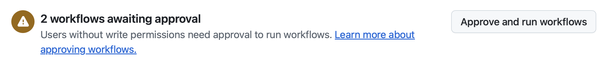

| [← Lección anterior: Supervisar y gestionar agentes][previous-lesson] |
|:--|

## Revisa el trabajo

Durante este taller has trabajado con GitHub Copilot en varias tareas para mejorar la experiencia y añadir funcionalidades. Le pediste que añadiera documentación al código, creara una funcionalidad de juegos relacionados para que el equipo de diseño pudiera iterar sobre la experiencia e implementara mejoras de accesibilidad con controles para los modos de alto contraste y claro. Vamos a revisar los cambios y, si hace falta, dar comentarios a Copilot para mejorarlos.

### Escenario

Como ya hemos indicado varias veces, los fundamentos del diseño de software y DevOps no cambian al añadir IA generativa. Siempre hay que revisar el código generado y seguir el proceso habitual de DevOps. Con esto en mente, revisaremos las propuestas de GitHub Copilot para la documentación, los juegos relacionados y las funciones de accesibilidad antes de activar la revisión para el resto del equipo.

## Seguridad y agente en la nube de GitHub Copilot

Como el agente en la nube de Copilot realiza las tareas de forma asíncrona y sin supervisión, se han establecido restricciones de seguridad para que el proceso sea seguro. Entre ellas:

- Copilot solo tiene acceso de lectura al repositorio y acceso de escritura **únicamente** a la rama que utiliza para el código.
- El agente en la nube se ejecuta en GitHub Actions, donde crea un entorno independiente y efímero para trabajar.
- Una persona debe aprobar cualquier flujo de trabajo de GitHub Actions antes de que pueda ejecutarse.
- [El acceso a recursos externos está limitado de forma predeterminada](https://docs.github.com/copilot/how-tos/copilot-on-github/customize-copilot/customize-cloud-agent/customize-the-agent-firewall), incluidos los servidores MCP.

## Revisa la documentación generada

Empezaremos por la primera solicitud de incorporación de cambios (PR) que generó el agente en la nube de GitHub Copilot: la que añade documentación al código. Usarás la interfaz habitual de PR de GitHub.com.

> [!NOTE]
> Al explorar la PR, es posible que veas una advertencia que indica que el firewall bloquea GitHub Copilot. Es **normal**, porque Copilot tiene acceso limitado a recursos externos de forma predeterminada, incluidas las llamadas a servidores MCP externos. Si quieres, puedes [personalizar o deshabilitar el firewall del agente en la nube de Copilot][agent-firewall].

1. Vuelve al repositorio en github.com.
2. Selecciona **Pull Requests** para abrir la lista de solicitudes.
3. Abre la solicitud cuyo título sea parecido a **Add missing documentation**.

> [!NOTE]
> Si Copilot sigue trabajando, el título de la PR incluirá la etiqueta **[WIP]**. Espera a que termine. Puede tardar unos minutos; mientras tanto, puedes hacer una pausa o repasar lo aprendido.

4. Cuando la PR esté lista, selecciona la pestaña **Files changed** y revisa los cambios.

    

5. Explora el código actualizado, que incluye los nuevos comentarios TSDoc y otra documentación. Los cambios concretos pueden variar.

    Al revisar los cambios, busca comentarios TSDoc, convenciones de TypeScript y encabezados de comentario. Proceden de los archivos de instrucciones personalizadas que revisaste al principio del ejercicio 2.

6. Cuando hayas revisado los cambios y todo parezca correcto, vuelve a la pestaña **Conversation** y desplázate hacia abajo.
7. Deberías ver un indicador que señala que algunos flujos de trabajo esperan aprobación.
8. Si hay flujos de trabajo pendientes, selecciona **Approve and run workflows**.

   
9. Los flujos de trabajo deberían aparecer en la sección de comprobaciones de la PR. Si todo va bien, las comprobaciones del proyecto para la aplicación Astro se superarán. El proceso puede tardar unos minutos.

## Pide cambios a GitHub Copilot

Trabajar con Copilot en una PR no es un proceso unidireccional. Puedes mencionarlo en comentarios de la solicitud, igual que harías con otras personas del equipo, o añadir comentarios en línea al código. Copilot verá esos comentarios e iniciará otra sesión para resolverlos. Como los resultados no son deterministas, no podemos recomendar un texto concreto. Puedes pedirle, por ejemplo, que:

- añada encabezados breves al principio de cada archivo de código para explicar su función.
- añada comentarios TSDoc a archivos TypeScript y Astro.
- cree un README que describa la estructura de la aplicación Astro.

1. Añade un comentario para solicitar un cambio en la documentación generada y menciona a **@copilot** como harías con cualquier otra persona. Usa una de las ideas anteriores u otra sugerencia que quieras aplicar a la documentación del código.
2. Selecciona **View Session** para observar el trabajo de Copilot. Verás que inicia una sesión nueva para realizar los cambios.
3. Puedes seleccionar **Back to pull request** para volver a la solicitud.

    

4. Cuando Copilot termine, debería aparecer un commit nuevo en la PR.
5. Selecciona **Files changed** para revisar los cambios.

Puedes seguir iterando hasta que estés conforme. Cuando lo estés, convierte la PR de borrador en lista para revisión y combínala en la rama principal.


## Revisa la funcionalidad de juegos relacionados

Volvamos a la PR que Copilot generó para resolver la incidencia sobre los juegos relacionados en la página de detalles.

1. Vuelve al repositorio en GitHub.com.
2. Selecciona la pestaña **Pull Requests**.
3. Selecciona la PR cuyo título sea parecido a **Show related games on the game details page**.
4. Selecciona **Files changed** para revisar el código generado.
5. Cuando hayas revisado los cambios y todo parezca correcto, vuelve a la pestaña **Conversation** y desplázate hacia abajo.
6. Deberías ver un indicador que señala que algunos flujos de trabajo esperan aprobación.
7. Si hay flujos de trabajo pendientes, selecciona **Approve and run workflows**.

   

8. Los flujos de trabajo deberían aparecer en la sección de comprobaciones de la PR. Si todo va bien, las comprobaciones del proyecto para la aplicación Astro se superarán. El proceso puede tardar unos minutos.
9. **Opcional:** puedes cambiar a esta rama en Codespaces para probar manualmente la funcionalidad de juegos relacionados. Abre el terminal y ejecuta estos comandos; sustituye `<branch-name>` por el nombre de la rama creada por Copilot, por ejemplo, **copilot/fix-8**:

    ```bash
    git fetch origin
    git checkout <branch-name>
    ```

Copilot ha creado la funcionalidad de juegos relacionados. Como antes, puedes trabajar de forma iterativa con el agente en la nube para pedir cambios. Por ejemplo, podrías solicitar que ajuste la cantidad de juegos relacionados o que añada encabezados de comentario y comentarios TSDoc (recuerda que asignaste esta tarea **antes** de actualizar las instrucciones personalizadas). Para ello, añade otro comentario en la pestaña **Conversation**; Copilot lo verá e iniciará una sesión nueva.

## Revisa las funciones de accesibilidad

Por último, revisaremos las funciones de accesibilidad que se implementaron con el agente personalizado de accesibilidad. Esta PR debería incluir el modo de alto contraste que asignaste en el ejercicio 3 y el modo claro que solicitaste desde el centro de control en el ejercicio 4.

1. Vuelve al repositorio en GitHub.com.
2. Selecciona la pestaña **Pull Requests**.
3. Selecciona la PR cuyo título sea parecido a **Add high contrast mode to website**.

> [!NOTE]
> Si Copilot sigue trabajando, el título de la PR incluirá la etiqueta **[WIP]**. En ese caso, espera a que termine; puede tardar unos minutos.

4. Selecciona **Files changed** para revisar el código generado.
5. Revisa la implementación y presta especial atención a:
   - los controles de la interfaz para cambiar entre modos.
   - el uso del almacenamiento local para conservar las preferencias.
   - los cambios de CSS o estilo para los modos de alto contraste y claro.
   - los atributos de accesibilidad, como las etiquetas ARIA y la navegación con el teclado.
   - el código JavaScript/TypeScript que gestiona los cambios de modo.

6. Cuando hayas revisado los cambios y todo parezca correcto, vuelve a la pestaña **Conversation** y desplázate hacia abajo.
7. Deberías ver un indicador que señala que algunos flujos de trabajo esperan aprobación.
8. Si hay flujos de trabajo pendientes, selecciona **Approve and run workflows**.

   

9. Los flujos de trabajo deberían aparecer en la sección de comprobaciones de la PR. Si todo va bien, las comprobaciones del proyecto para la aplicación Astro se superarán. El proceso puede tardar unos minutos.
10. **Opcional:** puedes cambiar a esta rama en Codespaces para probar manualmente las funciones de accesibilidad. Abre el terminal y ejecuta estos comandos; sustituye `<branch-name>` por el nombre de la rama creada por Copilot:

    ```bash
    git fetch origin
    git checkout <branch-name>
    ```

    Después, inicia la aplicación y prueba los controles de alto contraste y modo claro en el navegador. Confirma que funcionan y que la configuración se conserva al volver a cargar la página.

Observa cómo el agente personalizado de accesibilidad ha guiado a Copilot para implementar estas funciones siguiendo las prácticas recomendadas. Si detectas problemas o mejoras de accesibilidad, puedes mencionar a **@copilot** en un comentario para solicitar cambios, como hiciste con las PR anteriores.

## Ejercicio opcional: sigue delegando

El agente en la nube funciona mejor cuando le asignas elementos reales del backlog y te ocupas de otras tareas. Para crear ese hábito, registra más incidencias en tu repositorio y asígnaselas a Copilot. Algunas ideas:

- crear un formulario de interés de patrocinadores en la página de detalles del juego.
- implementar la paginación en la página de la lista de juegos.
- añadir validación de entradas y gestión de errores a los métodos auxiliares de acceso a datos.

## Resumen

Has completado el taller del agente en la nube. En estas lecciones:

- **Revisaste los archivos de instrucciones personalizadas del repositorio** para reconocer su efecto en el trabajo del agente en la nube.
- **Asignaste incidencias al agente en la nube de Copilot** y observaste cómo preparaba el entorno, planificaba y trabajaba de forma asíncrona.
- **Creaste y usaste un agente personalizado** de accesibilidad para añadir los modos de alto contraste y claro.
- **Usaste la página de agentes de Copilot como centro de control** para supervisar y dirigir la sesión de accesibilidad.
- **Revisaste las solicitudes del agente en la nube e iteraste sobre ellas**, mencionando a `@copilot` para solicitar cambios y aprobando flujos de trabajo.

## Repaso y pasos siguientes

Has completado el taller del agente en la nube. Si quieres seguir explorando, los otros talleres complementan lo que has practicado:

- 🖥️ **[Taller de VS Code](../../vscode/)**: explora el modo agente de Copilot Chat y la integración con MCP directamente desde el IDE.
- 💻 **[Taller de CLI](../../cli/)**: entrega desde el terminal dos cambios revisados con los modos Plan y Autopilot, habilidades de agente, un agente personalizado de QA, Playwright MCP, Agent Merge y el puente opcional `/delegate` con el agente en la nube.

En tu propio repositorio, prueba estas ideas:

- asigna al agente en la nube una incidencia de refactorización o cobertura de pruebas.
- crea un agente personalizado para otro ámbito.
- configura `copilot-setup-steps.yml` para otra pila tecnológica.

## Recursos

- [GitHub Copilot][github-copilot]
- [Acerca de los agentes de Copilot][copilot-agents]
- [Asignar incidencias de GitHub a Copilot][assign-issue]
- [Prácticas recomendadas para configurar el flujo de trabajo del agente en la nube][cloud-agent-best-practices]
- [Configurar el firewall del agente en la nube de Copilot][agent-firewall]

---

| [← Lección anterior: Supervisar agentes][previous-lesson] |
|:--|

[github-copilot]: https://github.com/features/copilot
[cloud-agent-overview]: https://docs.github.com/copilot/concepts/agents/cloud-agent/about-cloud-agent
[assign-issue]: https://docs.github.com/copilot/how-tos/use-copilot-agents/cloud-agent/start-copilot-sessions
[setup-workflow]: https://docs.github.com/copilot/how-tos/copilot-on-github/customize-copilot/customize-cloud-agent/customize-the-agent-environment
[copilot-agents]: https://docs.github.com/copilot/concepts/agents/cloud-agent/about-cloud-agent
[cloud-agent-best-practices]: https://docs.github.com/copilot/how-tos/copilot-on-github/customize-copilot/customize-cloud-agent/customize-the-agent-environment
[agent-firewall]: https://docs.github.com/copilot/how-tos/copilot-on-github/customize-copilot/customize-cloud-agent/customize-the-agent-firewall

[previous-lesson]: ../4-managing-agents/
