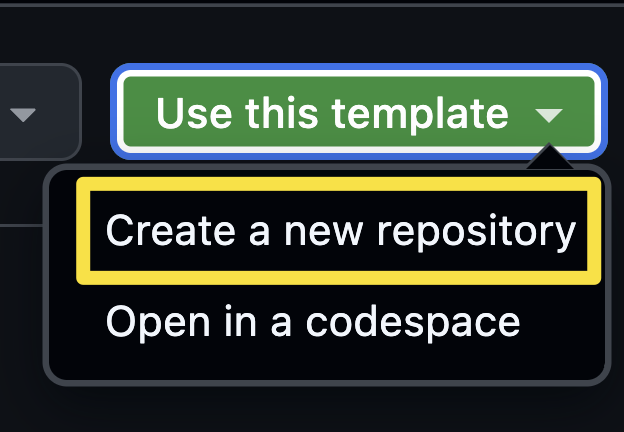

GitHub Copilot app 是一款桌面应用，也是使用 Copilot 和 GitHub 的中心位置。它可以快速访问议题和拉取请求，也能使用 GitHub Copilot 构建项目。本研讨会将在本机使用 GitHub Copilot app 更新基于 Astro 的 Tailspin Toys 应用。开始前先确认本机安装了 Node.js，然后安装 Copilot app。

本课将学习如何：

- 安装 Node.js，以便在本机运行项目测试。
- 从模板创建 Tailspin Toys 项目的个人副本。

## 安装 Node.js

多节课程会要求智能体构建功能并在本机运行 Tailspin Toys 测试套件。项目只需要 **[Node.js][nodejs]** 这一运行时。请安装当前的 **LTS** 版本。

所有平台都可使用官方安装程序：

1. 在操作系统中打开终端，例如 Windows Terminal、macOS 终端或平时使用的终端。
2. 运行以下命令，检查已安装的 Node.js 版本：

   ```shell
   node --version
   npm --version
   ```

3. 如果两个命令都能成功运行，且 Node.js 满足项目 README 和 `package.json` 中的要求，可以跳到下一节。

> [!TIP]
> 如果尚未安装 Node.js 或需要更新版本，才需要完成以下步骤。

4. 打开 [Node.js 下载页面][node-download]。
5. 下载适用于操作系统的 **LTS** 版本。
6. 运行安装程序并接受默认设置。在 Windows 上，请保持选中 **Add to PATH** 选项。
7. 安装后打开新的终端窗口。
8. 在新终端中运行以下命令，确认安装：

   ```bash
   node --version
   npm --version
   ```

9. 确认显示已安装的 Node.js 和 npm 版本。

> [!IMPORTANT]
> Copilot app 的智能体也必须能够运行 `node --version` 和 `npm --version`。常用终端中运行成功，不代表 app 一定能找到它们。安装 Node.js 或更改 PATH 后，请完全退出并重新打开 app。如果会话中仍无法运行命令，请按照[会话环境故障排除步骤][session-environment]处理，再继续。

> [!IMPORTANT]
> 每个工作树也需要项目依赖项和用于端到端 (E2E) 检查的 Playwright Chromium。准备工作树时请遵循 Tailspin Toys 存储库 README，并在批准安装请求前先审查。

## 设置实验室存储库

你将在自己的 Tailspin Toys 项目副本中进行操作。现在从[模板存储库][template-repository]创建副本。新存储库包含实验所需的全部文件，安装 app 时会连接它。

1. 在新的浏览器窗口中，打开本实验的 GitHub 存储库：`https://github.com/github-samples/tailspin-toys`。
2. 在实验室存储库页面上选择 **Use this template**，然后选择 **Create a new repository**，创建自己的存储库副本。

   

3. 如果你参加的是 GitHub 或 Microsoft 举办的活动，请遵循导师提供的说明。否则，可以在你有权使用 GitHub Copilot 的组织中创建存储库。

   

4. 记下创建的存储库路径（**organization-or-user-name/repository-name**），稍后会用到。

> [!NOTE]
> 从模板创建存储库时，系统会自动创建一组 GitHub 议题作为待办事项。整个研讨会都会使用这些议题，无需自行创建。

请使用研讨会模板的全新副本。它包含存储库指令、应用代码、测试、quality-checks 技能和现有画布扩展。研讨会中会自定义技能并创建 QA 智能体。如果使用旧副本，请与导师确认其中包含所需文件。

## 总结和后续步骤

环境已准备就绪！本课中你：

- 安装了 Node.js，以便在本机构建和测试项目。
- 从模板创建了 Tailspin Toys 存储库的个人副本。

接下来，[安装 GitHub Copilot app][next-lesson]、连接刚创建的存储库并熟悉工作区。

## 资源

- [下载 Node.js][node-download]
- [从模板创建存储库][template-repository]
- [关于 GitHub Copilot app][about-copilot-app]

[next-lesson]: ../1-install-copilot-app/
[nodejs]: https://nodejs.org/
[node-download]: https://nodejs.org/en/download
[template-repository]: https://docs.github.com/repositories/creating-and-managing-repositories/creating-a-template-repository
[about-copilot-app]: https://docs.github.com/copilot/concepts/agents/github-copilot-app
[session-environment]: ../3-agent-modes/
